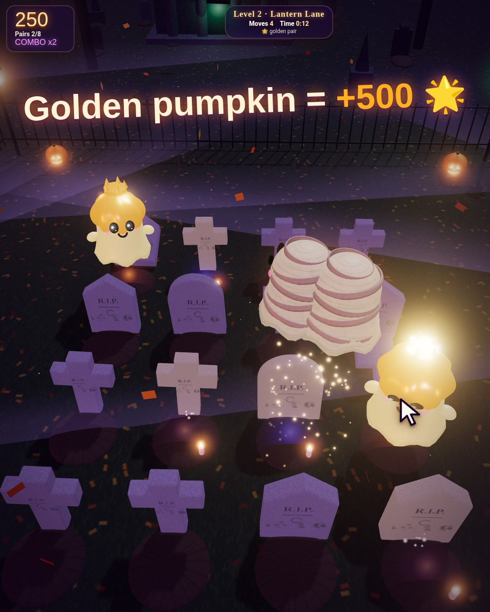

# 👻 Ghost Memory

A cozy-spooky 3D memory game in a moonlit graveyard. Flip gravestones, meet 15 cute ghosts, and find the pairs: a sneaky ghost swaps your stones, fog rounds hide the board, a golden pumpkin pair is worth +500, and there's a Kids mode plus a 2-player duel on one device.

**▶ Play in your browser:** [online version (GitHub Pages)](https://frank-otto.github.io/ghost-memory/)

🎬 [Watch the gameplay video (MP4, 27 s)](media/ghost-memory-x.mp4)

Built with Grok Bot · [@Frank_AI_Lab](https://x.com/Frank_AI_Lab)

---

A 3D Halloween memory game in a moonlit graveyard (Three.js, bundled into one classic script so a double-click on `index.html` works from `file://`).

- Gravestones are the cards: click/tap (or arrows + Enter) to tilt one back and a ghost rises from the grave. 14 ghost types plus a golden pumpkin, each with its own look, idle animation and soft giggle.
- Match → the two ghosts dance and swirl up into the sky as sparkles (points + combo bonus). Mismatch → they shrug and sink back.
- Levels 3×4 → 4×4 → 4×5 → 5×6 with moves, timer, star rating and best scores (localStorage).
- Twists: golden pumpkin pair (+500), a cheeky ghost who swaps two unrevealed stones (level 3+), fog rounds (level 4).
- 2 players on one device (default Player 1 vs Player 2): turns, scores, winner celebration.
- Kinder-Modus: 3×2 / 4×3 / 4×4, a long peek at the start, no timer, at least 2 stars.
- EN/DE, quality Niedrig/Mittel/Hoch/Ultra with an FPS-based suggestion, tutorial (also via "?"), 1080×1350 end card PNG, share text EN/DE.

Run: double-click `index.html`, or `start.command` (local server on port 8805).
Build: `npm install && node tools/build.mjs` (embeds `sounds/*.mp3` as base64 into `js/sounds-src.js`).
Tests: `python3 test/test_game.py` (Playwright + Chrome) → `test/results.txt`, screenshots in `screenshots/`.
Sounds: CC0, see `LICENSES/SOUNDS.md`.
